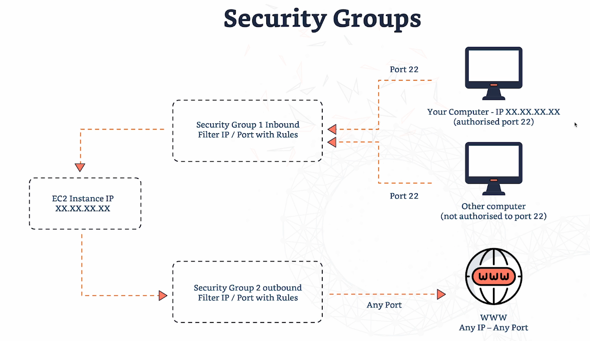
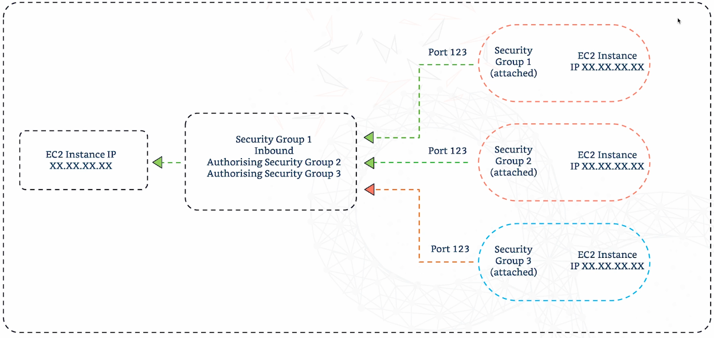

# Security Groups (SGs)

- **What they are:** Virtual firewalls that control the traffic going **into and out of** your EC2 instances.

- **Allow rules only:**
  - Unlike a traditional firewall, a security group has **no deny rules**.
  - Anything that isn't explicitly allowed is **blocked by default**.

- **What a rule can allow traffic from:**
  - **IP addresses**, such as one IP, a range, or anywhere (`0.0.0.0/0`)
  - **Other security groups**, which lets your instances talk to each other without being exposed to the public internet. This is useful in large environments.

- **Stateful:** If inbound traffic is allowed, the reply going back out is automatically allowed too, and the same works the other way round. You don't need a separate rule for the response.

## Example: a website on EC2

| Port | Protocol | Allowed? |
|---|---|---|
| 80 | HTTP | ✅ Allowed |
| 443 | HTTPS | ✅ Allowed |
| 22 | SSH | ❌ No rule, so blocked |
| 3306 | Database (MySQL) | ❌ No rule, so blocked |

Only add rules for the traffic you actually need. Everything else stays blocked.

# Security Groups: What They Control

- **Ports:** Which ports are open on your instance.
  - For example, a web server needs port 80 (HTTP). Never open every port, because that exposes the instance to unwanted traffic.

- **Allowed IP ranges (IPv4 and IPv6):** Who can reach the instance, based on their IP address.
  - For example, only allow SSH from your home, office or another trusted IP.

- **Inbound traffic:** Traffic coming **into** the instance, such as web requests, SSH connections or database access.

- **Outbound traffic:** Traffic **leaving** the instance. You can restrict what it's allowed to connect to, for example blocking internet access unless it's really needed.

## Example inbound rules

| Type | Protocol | Port | Source | Meaning |
|---|---|---|---|---|
| HTTP | TCP | 80 | `0.0.0.0/0` | Open to the whole world |
| SSH | TCP | 22 | `192.168.1.85/32` | Only one IP address (`/32` = a single IP) |
| Custom TCP | TCP | Any port or range you choose, e.g. `8080` | Your choice | For an app that listens on its own port |

## Best practice

- Keep rules **as tight as possible**.
- Only open the ports you **actually need**.
- Only allow access from **trusted IPs**.
- This keeps your instance less exposed to attacks.


# How Security Groups Work


- **Every EC2 instance has a security group attached.** It acts like a virtual bouncer, only letting in traffic that matches your rules.
- **Rules filter traffic by IP address and port.**

## Inbound (traffic coming in)

- ✅ **Your computer** has an authorised IP for port 22, so its SSH connection is **allowed**.
- ❌ **Another computer** doesn't have an authorised IP, so its attempt on port 22 is **blocked**.
- Only allow access from **trusted IPs**.

## Outbound (traffic going out)

- **By default, all outbound traffic is allowed**, to any IP on any port.
  - For example, the instance can download updates or call an external API.
- **Recommended:** remove the default "allow all" rule and only allow the outbound traffic the instance actually needs.

## Takeaway

- Security groups control **who** can connect (their IP) and **how** they connect (the port).
- Your instance stays **locked down** unless a connection matches a rule.

# Security Groups: Key Facts

- **Reusable:** One security group can be attached to **many EC2 instances**, which makes managing access much easier.

- **Tied to a region and VPC:** A security group only works in the region and VPC it was created in. You can't use it in another region or VPC.

- **Sits outside the instance:** The security group is a layer **in front of** the instance. Blocked traffic never reaches the instance at all.

- **Good practice:** Keep a **separate security group just for SSH**. You can then tightly control which IPs can SSH in without touching your web or app rules.

## Default behaviour

| Direction | Default |
|---|---|
| **Inbound** | ❌ All blocked. You must add rules, e.g. HTTP, HTTPS or SSH |
| **Outbound** | ✅ All allowed. The instance can reach the internet and other instances |

## Troubleshooting

| Error | Likely cause |
|---|---|
| **Timeout** (it just hangs) | 🔒 **Security group** is blocking the traffic. Check the SG rules first |
| **Connection refused** | ⚙️ **Instance or app** problem: the service isn't running or is misconfigured. Not an SG issue |

> 💡 If you can't reach a web server, it's usually the security group. A timeout is your first hint.

# Referencing Other Security Groups


- **The problem:** Security group rules usually use **IP addresses**. But IPs change, for example when Auto Scaling adds and removes instances, and updating rules by hand is painful.

- **The solution:** A rule's **source can be another security group** instead of an IP.
  - Any instance that has that security group attached is allowed in, whatever its IP is.


## Why it's useful

- **No IP addresses to manage.** You allow whole groups of instances instead.
- **It works in dynamic environments** such as Auto Scaling groups and clusters, where instances come and go.
- **Example (microservices):** The **database tier's** security group allows traffic from the **app tier's** security group. Every app server can reach the database, and nothing else can.

```
[App tier instances]  ──►  [Database tier instances]
      SG-App                 SG-DB
                             Inbound rule: source = SG-App
```


## Example


The EC2 instance on the left uses **Security Group 1** for its inbound rules. Instead of IP addresses, the rules name **security groups** as the source.

| Instance trying to connect | Its security group | Port | Result |
|---|---|---|---|
| Instance A | SG1 | 123 | ✅ Allowed (green arrow) |
| Instance B | SG2 | 123 | ✅ Allowed (green arrow) |
| Instance C | SG3 | 123 | ❌ Blocked (orange arrow) |

- It doesn't matter what IP each instance has. **Only the security group attached to it matters.**
- An instance whose security group isn't named in the rules is **blocked**, even on the right port.

# Classic Ports to Know

When you write security group rules, you open or block **ports**. Each port belongs to a particular service.

| Port | Service | What it's for |
|---|---|---|
| **22** | **SSH** (Secure Shell) | Securely log in to a **Linux** instance |
| **22** | **SFTP** (Secure FTP) | Transfer files securely. It runs over SSH, which is why it shares port 22 |
| **21** | **FTP** (File Transfer Protocol) | Upload files to a file share. ⚠️ Not secure and being phased out, so use SFTP instead |
| **80** | **HTTP** | Unencrypted websites |
| **443** | **HTTPS** | Secure, encrypted websites (TLS) |
| **53** | **DNS** | Turns domain names (e.g. `google.com`) into IP addresses |
| **3389** | **RDP** (Remote Desktop Protocol) | Log in to a **Windows** instance |
| **25** | **SMTP** | Sending email |
| **3306** | **MySQL** | MySQL database |
| **5432** | **PostgreSQL** | Postgres database |

## Tips

- 🔒 **Only allow port 22 (SSH) from trusted IPs.**
- Use **SFTP instead of FTP**, and **HTTPS instead of HTTP**.
- Linux instances use **SSH (22)**. Windows instances use **RDP (3389)**.

# Security Groups in the Console (Hands-on)

## Viewing a security group

- Select your instance → open the **Security** tab to see the security group attached to it.
- Or go to **EC2 → Security Groups** in the left menu.
  - `launch-wizard-1` was created automatically when the instance was launched.
  - `default` is the security group that comes with your VPC.
- Each security group has a **name**, a **Security group ID** (e.g. `sg-0abc123...`), **inbound rules** and **outbound rules**.

## Existing inbound rules (`launch-wizard-1`)

| Type | Port | Source |
|---|---|---|
| SSH | 22 | Anywhere (`0.0.0.0/0`) |
| HTTP | 80 | Anywhere (`0.0.0.0/0`) |

## Adding a rule

- **Edit inbound rules → Add rule**
- Choose a type from the dropdown, such as **HTTPS**. The port (443) fills in automatically.
- Choose the source, e.g. **Anywhere**, then **Save rules**.

## Testing: remove the HTTP rule

1. Delete the **HTTP (port 80)** rule and save.
2. Refresh the website. It **keeps loading and then times out**.
3. ⏱️ **A timeout means the security group is blocking the traffic.**
4. Fix it: **Edit inbound rules → Add rule → HTTP, port 80, Anywhere → Save**.
5. Refresh. ✅ The website works again.

> 💡 **If the page keeps loading or times out, check the security group first.**

# Security Groups: Outbound Rules (Hands-on)

## Default outbound rule (`launch-wizard-1`)

| Type | Protocol | Port | Destination |
|---|---|---|---|
| All traffic | All | All | Anywhere (`0.0.0.0/0`) |

- This gives the instance **full internet access**, for example to download and install packages.
- ⚠️ If you remove it, things like `yum install` **won't work**, because the instance can't reach the internet.

## Adding a specific outbound rule (e.g. DNS)

- **Edit outbound rules → Add rule**
- Choose **DNS (UDP)** from the dropdown, or type port **53**. There is also a TCP version on port 53.
- Set the destination and **Save rules**.

## Best practices

- **Outbound:** "All traffic to anywhere" is usually fine. It lets the instance download what it needs.
- **Inbound:** Only open the ports you actually need.
- **SSH (22):** Avoid "Anywhere". Set the source to **My IP** so only your computer can connect.
  - **Edit inbound rules → SSH rule → Source → My IP**

  # IP Addresses: IPv4 vs IPv6

An **IP address** identifies a device on a network.

## IPv4

- The **older and most common** format. It has been around since the 1980s and is still the most used today.
- Made of **4 numbers separated by dots**, each between **0 and 255**.
  - Example: `10.16.0.104`
- About **3.7 billion** public addresses. That seemed like plenty at first, but it's no longer enough.

## IPv6

- Introduced because **we were running out of IPv4 addresses**, mostly because of the **Internet of Things** (phones, cameras, smart fridges and so on).
- Longer, more complex format using numbers and letters, separated by colons.
  - Example: `2001:0db8:85a3:0000:0000:8a2e:0370:7334`
- Allows a **huge number** of addresses.

## Quick comparison

| | IPv4 | IPv6 |
|---|---|---|
| Example | `10.16.0.104` | `2001:db8::8a2e:370:7334` |
| Format | 4 numbers, dots | 8 groups, colons |
| Number of addresses | ~3.7 billion public | Practically unlimited |
| Usage today | Most common | Growing |

> 💡 This course uses **IPv4**, the most common format and the easiest to start with.

# Private vs Public IPs and the Internet Gateway

## Private IPs

- Used **inside** a private network, such as your home or a company.
  - Example: `192.168.x.x`
- **Can't be routed on the public internet**, so they can't reach websites directly.
- **Can be reused** in different networks. Company A and Company B can both use the same private IPs.

## Public IPs

- Used **on the internet**.
- **Globally unique.** No two devices on the internet share one.
- Web services such as websites have their own public IPs.

## Internet gateway (like your home router)

- Connects a **private network** to the **public internet**.
- Performs **NAT (Network Address Translation)**: it swaps **private IPs ↔ public IPs** so traffic can travel over the internet and come back.
- **Without it, the private network is cut off** and can't reach any website or service online.
- Works at **Layer 3 (the network layer)**, routing traffic between different networks.

```
[Company A devices]                          [Company B devices]
  private IPs                                  private IPs
       │                                            │
 Internet Gateway (NAT)                      Internet Gateway (NAT)
  private → public IP                          private → public IP
       │                                            │
       └──────────────►  INTERNET  ◄────────────────┘
                            │
                     [Web services]
                       public IPs
```

> 💡 **Home analogy:** Your router gives your devices private IPs (`192.168...`) and translates them into your one public IP when you browse the web. An internet gateway does the same job for a company's (or AWS) network.

# Public vs Private IP Addresses

## Public IP

- Makes a machine **visible on the internet**, such as a web server or your home router.
- **Unique across the whole internet.** No two devices can have the same public IP at the same time.
  - 🏠 Like a home address: no two houses share the exact same one.
- **Can be roughly located.** Websites can often tell which country or city it's in, which is used for localised content and targeted ads.

## Private IP

- Only used **inside a private network**, such as your home or a company's internal network.
- Devices in the network can see each other, but they **can't be seen directly from the internet**.
- Only needs to be **unique within its own network**.
- **Can be reused in different networks.** Company A and Company B can both use `192.168.0.1` without any conflict, because they're on **different** networks.

## Side by side

| | Public IP | Private IP |
|---|---|---|
| Visible on the internet? | ✅ Yes | ❌ No |
| Unique where? | Across the whole internet | Only within its own network |
| Can be reused? | ❌ No | ✅ Yes, in different networks |
| Example | A web server, your home router | Your laptop at home (`192.168.x.x`) |

# Elastic IP

## The problem

- When you **stop and start** an instance, it usually gets a **new public IP**.
- AWS hands out public IPs dynamically, so there's no guarantee you'll keep the same one.

## The solution: Elastic IP

- A **fixed public IP** that stays the same no matter what.
- It's **yours** until you release (delete) it.
- Can be attached to **one instance at a time**, but you can **move it** to another instance whenever you need to.

## Cost

- 💰 **Not attached to a running instance:** AWS charges you for holding it. **Release any Elastic IPs you aren't using.**
- **Attached to a running instance:** see the note below about current pricing.

## When to use it

- Running a **web server** that needs a consistent address.
- **DNS records** pointing at your instance.
- **External services** that connect to your instance by IP.
- ✅ The IP stays the same after restarts, so nothing breaks.

> 💡 **Tip:** If you don't need a fixed public IP, you don't need an Elastic IP.

# Elastic IP (Hands-on)

## 1. Allocate an Elastic IP

- **EC2 → Network & Security → Elastic IPs → Allocate Elastic IP address**
- Keep the defaults (your region, Amazon's pool of IPv4 addresses) → **Allocate**
- AWS gives you a public IPv4 address to use.

## 2. Launch an instance

- **Instances → Launch instance**
- **Name:** `elastic-ip-instance`
- **AMI:** Amazon Linux (default)
- **Instance type:** `t2.micro` (free tier)
- **Key pair:** create a new one (RSA)
- **Network settings → Edit:**
  - ⚠️ **Auto-assign public IP: Disable.** We'll use the Elastic IP instead of a random one.
  - Allow SSH traffic from **My IP**
- **Launch.** The instance has **no public IP** yet.

## 3. Attach the Elastic IP to the instance

- **Elastic IPs →** select your IP **→ Actions → Associate Elastic IP address**
- **Resource type:** Instance → choose your instance from the dropdown
- Tick **Allow this Elastic IP address to be reassociated** → **Associate**
- ✅ The instance now has the Elastic IP as its **public IP**.

## 4. Clean up (important!)

💰 AWS charges you for Elastic IPs you aren't using, so delete everything when you finish the lab:

1. **Elastic IPs → Actions → Disassociate Elastic IP address**
2. **Actions → Release Elastic IP address.** The IP is no longer yours.
3. **Instances →** select the instance **→ Instance state → Terminate instance**

# Elastic IPs: When to Use Them and When to Avoid Them

## Why use them

- **Hide a failure:** if an instance or its software fails, quickly **move the Elastic IP to a healthy instance**.
- Switch traffic from one instance to another **without downtime**.

## Limit

- **5 Elastic IPs per region per account** by default. You can ask AWS for more.

## Why avoid them

- ⚠️ **Best practice: only use Elastic IPs when you really need to.**
- They're often a sign of **poor architecture**, a "band-aid" fix.
- Needing lots of them means you should **rethink your setup**.

## Better alternatives

| Option | How it helps |
|---|---|
| **Random public IP + DNS name** | People connect using a name (e.g. `app.example.com`) instead of a fixed IP. Update the DNS record if the IP changes |
| **Load balancer** ⭐ | Gives you one stable DNS name and spreads traffic across instances. More flexible and reliable (covered later) |

> 💡 **Takeaway:** Elastic IPs are fine for quick recovery, but for scalable, modern setups use **DNS or a load balancer**.


